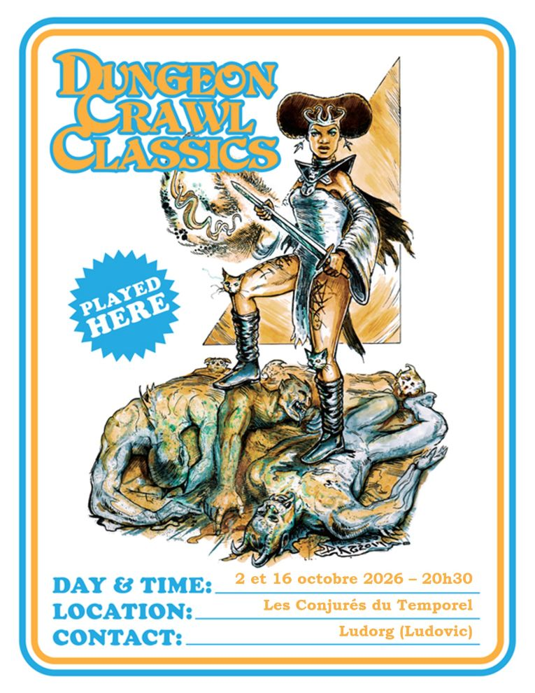
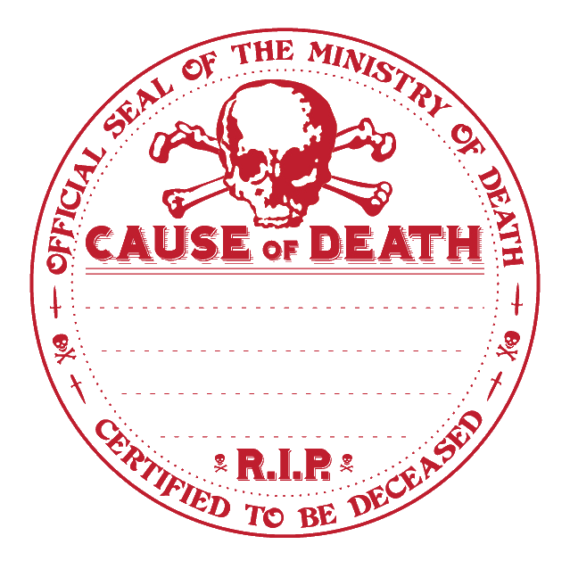

# DCC - La Garnison Royale arrive à la ferme du Vieux Buck

Vendredi 16/10/2026 ; 20h30-00h00 ; Les Conjurés du Temporel

Suite des aventures à la [ferme du vieux Buck](./dcc_cdt_2026_10_02), avec de nouveaux joueurs et de nouveaux personnages qui entrent en scène.

## Précédemment

Les héros, revenus de la Brèche dans le Ciel, se reposent quelque temps au village de Mherkin.
Belle et Wulf Gangus y étudient la magie, tandis qu'Albert se consacre à Justicia.

Trois semaines plus tard, Némid l'Ancien les envoie aider le vieux Buck, dont les animaux deviennent fous et dont les commis ont disparu.

À la ferme, les aventuriers affrontent des cochons bipèdes et une poule monstrueuse qui pétrifie ses victimes.
Ils découvrent ensuite un poulain‑licorne blessé, qu'ils soignent et qui révèle que des chasseurs ont attaqué sa mère.
En suivant les traces de sang, ils trouvent un mystérieux portail rose dans le champ de radis.
Pendant que certains enquêtent près de l'étang de la ferme, Raya et Albert sont entraînés dans une danse par des fées joueuses surgies des buissons fleuris.

## Personnages et Joueurs

- Elena
  - Lilylia, Guerrière (Fermière)
  - Raya, Voleuse (Serrurière)

- Augustin
  - Belle, Mage (Orpheline)
  - Gloin, Nain (Nain Forgeron)

- Félix
  - Gurdil, Nain (Nain Myciculteur)

- Stéphanie
  - Khar-Schi-Mõn, Diseur de bonne aventure
  - Waff, Mendiant de Guilde

- Enzo
  - Tomas, Soldat
  - Valor, Elfe Avocat [RIP ?]

### Héros au repos, ou en retrait du groupe

- Sophie
  - Amalia, Halfeline (Halfeline Bohémienne)
  - Wulf Gangus, Mage (Ménestrel)

### PNJ accompagnant les héros

- Albert, Clerc de Justicia (Fromager)

## Périls et dangers

### Des renforts pour les aventuriers novices

À Mherkin, Némid l'Ancien pressent que la situation à la ferme du vieux Buck est plus compliquée que prévue.
Il dépêche donc en urgence une petite troupe de renforts, rassemblée par Gurdil à sa demande.
Le nain myciculteur arrive accompagné de Cwentale, le fils du vieux Buck et d'un groupe aussi disparate qu'improbable :

- Khar‑Schi‑Mõn, diseur de bonne aventure, dont les prédictions inquiètent autant qu'elles intriguent ;
- Waff, mendiant de guilde, qui traine parfois avec Traboc aux abords de l'Outre du Marin Maudit ;
- Tomas, soldat de la garde de Mherkin ;
- Valor, elfe avocat, dont les discours sont aussi affûtés qu'une lame en mithril.

Tous ont été envoyés pour prêter main‑forte aux aventuriers déjà sur place... et surtout pour prévenir le vieux Buck que les soldats de la garnison royale approche.
Car Cwentale, le fils du fermier, est revenu de son périple vers Velmir Keep.
Il a vu la troupe se mettre en marche, et ce qu'il raconte glace le sang : les soldats du royaume de Morrain ne sont pas réputés pour leur clémence.
Il craint qu'ils ne rasent la ferme de son père sans chercher à comprendre. Et à leur tête marche la Sergente Holtric, vétérane des guerres contre les géants.
Sa réputation la précède : elle ne tolère rien qui ressemble de près ou de loin à de la magie.
Si quelque chose d'étrange se cache dans la grange, elle n'hésitera pas à le brûler, quitte à réduire la ferme du vieux Buck en cendres.

### Un combat au bord de l'étang

Alors que les renforts approchent de la ferme, un vacarme soudain les alerte : un combat a éclaté au bord de l'étang.
Gloin et Lilylia y sont déjà aux prises avec des hommes‑grenouilles et des hommes‑poissons, des créatures amphibies brandissant de longues lances en roseau.

Belle, suivie de la troupe fraîchement arrivée, se précipite pour leur prêter main‑forte.
Le chaos est immédiat : les adversaires bondissent hors de l'eau, frappant de leurs armes végétales, tandis que les aventuriers tentent de contenir l'assaut.

Dans la fureur de l'affrontement, Belle lance un charme‑personnes sur l'un des hommes‑poissons, qui se dirige vers elle, docile, mais l'instant de répit est de courte durée.
Ignorant que la créature est ensorcelée, Gurdil abat sa hache d'un coup sec, écrasant le malheureux.
Lorsque le corps retombe, il redevient un simple poisson, toujours vivant.
Waff, pris d'un élan de compassion ou de superstition, ramasse le poisson et le remet dans l'eau.

La bataille continue. Waff, voulant aider, tire une bille de fronde... qui rate sa cible et vient percuter Gloin le nain en pleine mêlée.
Un coup malheureux, mais parfaitement à l'image du chaos qui règne autour de l'étang.

La fureur du combat retombe et tous les poissons et les grenouilles sont revenus dans l'étang.

### Les fées dans le buisson

Pendant que le combat fait rage au bord de l'étang, Raya et Albert sont toujours prisonniers de l'étrange enchantement des fées.
Ces créatures qui ne sont, en réalité, que de simples papillons transformés, dispersent dans l'air une sorte de poudre dorée dangereusement euphorisante.

Leurs compagnons, alertés par leurs rires et leurs mouvements étrangement gracieux, s'approchent des buissons fleuris sur le côté de la grange.
À peine franchissent-ils la lisière que les fées virevoltantes tentent de les attirer à leur tour dans leur danse.

Certains aventuriers vacillent, un sourire béat aux lèvres, mais les autres parviennent à les sortir de leur transe, les ramenant à la réalité.

Khar‑Schi‑Mõn réussit à emprisonner deux de ces créatures dans sa flasque. Mais au bout d'un certain temps, l'une d'elle redevient un papillon.

Cherchant une solution plus pragmatique pour capturer d'autres fées, Belle se souvient de l'équipement aperçu à l'entrée de la ferme.
Elle s'empare alors de la combinaison d'apiculteur et de l'enfumoir. Mais sans succès, car les fées‑papillons se dispersent, avant de disparaître dans les champs.

### Dans la grange

Craignant l'arrivée imminente de la Sergente Holtric et de son regard impitoyable, les héros novices recouvrent les statues des commis pétrifiés d'une bâche, espérant dissimuler ces malheureux de la future inspection de la garnison.

Ils aident également le poulain à se diriger vers le portail, le rassurant pour qu'il avance sans crainte.

### De l'autre côté du portail

Pendant que certains s'affairent autour de la grange, Tomas et Gurdil décident courageusement de franchir le mystérieux portail rose.

De l'autre côté, ils émergent dans une forêt dense, saturée de plantes inconnues. Un vert profond, presque irréel, enveloppe chaque feuille.
Les arbres montent si haut qu'ils masquent entièrement le ciel, et la végétation est si compacte qu'ils ne distinguent qu'à peine quelques mètres devant eux.
Cette forêt semble infinie ; on pourrait y marcher des jours sans en trouver la limite.

Ils débouchent finalement dans une clairière circulaire, parfaitement dégagée autour du portail.
Toutes les plantes ont été arrachées, les troncs coupés net, et le sol est recouvert d'un tapis de feuilles et de brindilles, comme si quelque chose avait volontairement préparé cet espace.

Non loin, une seconde zone dégagée attire leur attention : une légère odeur de fumée flotte dans l'air, suggérant une présence récente ou un campement abandonné.

Par un malheureux concours de circonstances, Gurdil se prend les pieds dans un piège à loup, qui se referme brutalement sur sa cheville.
Dans le même instant, Tomas est soulevé du sol, la tête en bas, suspendu à un piège dissimulé dans les branchages.
Les deux aventuriers se retrouvent immobilisés, pendus et entravés, dans ce monde inconnu.

Gurdil s'extrait du piège et libère Tomas. Ils sont rejoints par le reste de la troupe avec le poulain et se dirigent vers l'autre clairière.

### La licorne blessée

En progressant vers la zone d'où provient l'odeur de fumée, les explorateurs découvrent une scène bouleversante.
Au milieu d'un espace dégagé, près d'un feu de camp éteint, repose une créature adulte semblable à un cheval, mais dont la nature ne laisse aucun doute.
Même dans la pénombre de cette forêt étrangère, sa silhouette semble briller  : un corps blanc, une longue queue, une crinière irisée aux couleurs de l'arc‑en‑ciel, et sur son front, une corne étincelante.

La licorne est vivante, mais terriblement affaiblie. Elle utilise sa corne pour refermer lentement ses blessures, une magie lente, douloureuse, presque désespérée.
Autour d'elle gisent plusieurs cadavres d'humanoïdes bleu marine, aux grands yeux de poisson. Leurs armes, leurs sacs et les objets éparpillés autour du feu indiquent clairement qu'il s'agissait de chasseurs.
Un combat féroce a eu lieu ici, et la licorne l'a remporté à un prix très élevé.

En observant les lieux, les aventuriers remarquent qu'un arbre porte encore une corde brisée, et que la licorne a une corde du même type enroulée autour du corps.
Tout devient clair : les chasseurs avaient capturé la licorne, l'avaient attachée à l'arbre, et se reposaient en préparant un piège destiné au poulain‑licorne.
À un moment, la licorne s'est libérée et a massacré ses geôliers.

Autour du feu, les héros novices fouillent les restes du campement.
Ils trouvent des pièces d'or étranges, frappées de symboles inconnus, qui ne ressemblent à aucune monnaie en circulation dans le royaume de Morrain.

Ils découvrent également un collier de cheval doré, finement ouvragé.
Valor, l'elfe avocat, reconnaît immédiatement les motifs gravés : ce sont des symboles du Roi des Terres Elfiques, une entité surnaturelle qui règne sur les royaumes verdoyants d'Elfland.

Comme avec son poulain, les femmes du groupe parviennent à communiquer avec la licorne.
La créature, épuisée mais lucide, leur confie que le portail va bientôt se refermer : le retour de son enfant en est la cause, et c'est mieux ainsi, car si le passage restait ouvert, les chasseurs pourraient revenir.

Alerté par cette révélation, l'un des novices retourne vers le portail pour vérifier.
Il constate que le passage a déjà diminué de moitié.

Alors que le groupe se prépare à repartir, Valor s'attarde auprès de la licorne.
Plus il en apprend sur Elfland, plus il est fasciné. Les symboles du collier, les récits de la licorne et la perspective de découvrir les lois et les coutumes des Terres Elfiques éveillent en lui une curiosité irrésistible.

Après une longue réflexion, il annonce sa décision : il ne reviendra pas dans le royaume de Morrain. Plutôt que de reprendre son ancienne vie, il choisit d'explorer ce monde féérique et de chercher la cour du Roi des Terres Elfiques.

Ses compagnons lui adressent un dernier salut avant de franchir le portail. Alors que celui-ci se rétrécit lentement, plusieurs aventuriers croient apercevoir au loin des silhouettes élancées sortir entre les arbres gigantesques. L'une d'elles semble attendre Valor auprès d'un ancien sentier envahi par la mousse. Avant que quiconque puisse en être certain, le passage se referme définitivement.

### Négociations avec la Sergente Holtric

Lorsque les aventuriers repassent le portail, le petit matin les accueille.
Pourtant, ils l'avaient franchi à la tombée de la nuit : le temps ne semble pas s'écouler de la même manière entre les deux mondes.

À la ferme du vieux Buck, le calme est revenu.
Sous la bâche qui les recouvrait dans la grange, les trois commis pétrifiés se réveillent, retrouvant chair et mouvement comme si leur terrible immobilité n'avait été qu'un mauvais rêve.

Ce répit ne dure qu'un instant.
Une troupe d'une dizaine de soldats arrive en formation serrée, soulevant la poussière du chemin.

Avant qu'ils n'atteignent la ferme, les aventuriers et le vieux Buck s'accordent rapidement sur une version des faits qui pourra satisfaire la curiosité inquisitrice de la Sergente Holtric.

L'inspection est minutieuse, les questions nombreuses et les échanges parfois tendus.

Malgré leurs explications, la Sergente Holtric demeure méfiante. Lorsqu'elle annonce que Cwentale sera incorporé de force dans la garnison royale, Tomas ne peut rester silencieux. Ancien soldat lui-même, il s'avance et plaide la cause du jeune homme. Il rappelle les efforts accomplis pour protéger la ferme, souligne la loyauté de la famille du vieux Buck envers le royaume et affirme qu'arracher Cwentale à son père ne servira ni la justice ni la sécurité du pays.

Pendant quelques instants, la tension devient palpable. Holtric écoute sans l'interrompre, puis rejette sèchement ses arguments. Les ordres sont les ordres, et la vétérane n'entend pas les discuter. Tomas ne parvient pas à infléchir sa décision, mais son intervention lui vaut le respect du vieux Buck et de plusieurs de ses compagnons.

Toutefois, la soldate ne repart pas sans laisser de traces :
le vieux Buck écope d'une amende salée, officiellement pour négligence et trouble potentiel à l'ordre royal.
Une partie de cette somme est payée grâce à la générosité de Lilylia, qui allège le fardeau du fermier.

Quant à Cwentale, le fils du vieux Buck, son sort est scellé :
la garnison l'enrôle de force, estimant qu'un homme ayant déjà voyagé jusqu'à Velmir Keep sera utile dans leurs rangs.
Le jeune homme se prépare à repartir avec eux, le regard sombre, conscient qu'il quitte la ferme pour un avenir incertain.

## Les héros tombés à l'Aventure

Dans le tableau ci-dessous, les héros qui ne reviendront pas de ce périple et la cause de leur disparition.

| Personnage | _Cause of Death_ |
| --- | --- |
| Valor, Elfe Avocat | Disparu dans les mystérieuses Terres Elfiques, au-delà du portail rose. |

<!-- markdownlint-disable MD026 -->
## À suivre...

Certains prétendent qu'à certaines nuits, lorsque la brume s'élève au-dessus des champs du vieux Buck, on peut entendre une voix lointaine portée par le vent venant de l'endroit où se dressait autrefois le portail rose. D'autres racontent qu'un voyageur égaré aurait aperçu, entre les troncs argentés d'une forêt impossible, la silhouette d'un elfe vêtu à la manière des gens de Morrain. Comme toutes les histoires venues d'Elfland, nul ne sait où finit la vérité et où commencent les légendes.

_Rapporté par Copaïlaut, gardien des secrets des Terres Elfiques._
